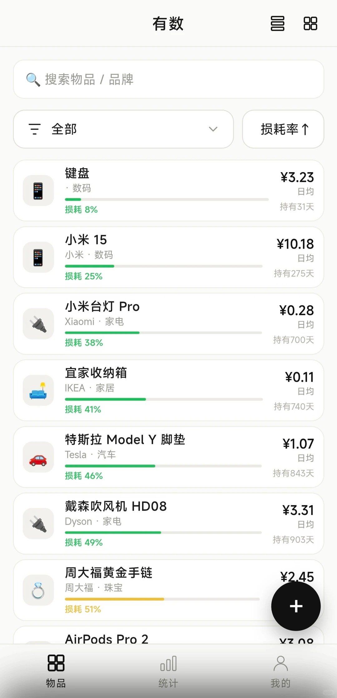
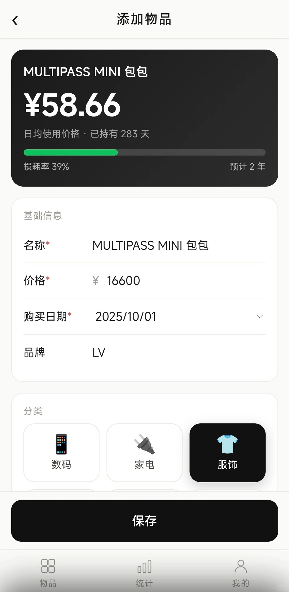
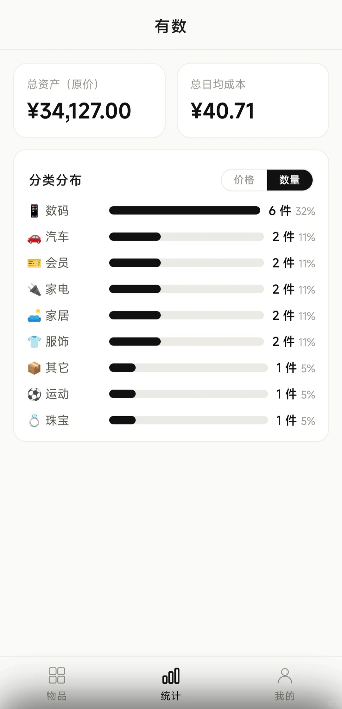
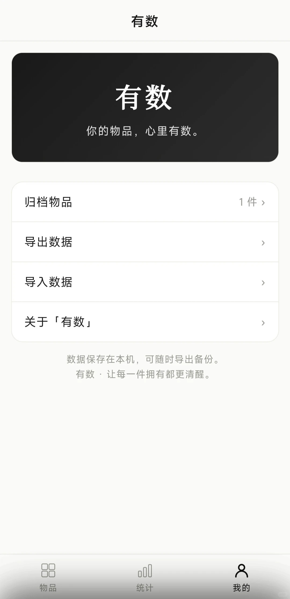

# 有数 (YouShu)

> **你的物品，心里有数。**

「有数」是一款**个人物品管理**工具，主打极简录入 + 自动量化「日均使用价格 / 损耗率 / 持有时间」，帮你用数据掌控自己的每一件物品。

## 效果展示

### 物品列表

首页以卡片形式展示所有物品，每张卡片一目了然地呈现**日均使用价格**、**损耗进度条**（按阈值绿/黄/红配色）和**持有天数**。支持按分类筛选、按损耗率排序、搜索，以及列表/方格双视图切换。



### 添加物品

录入只需填写名称、价格、购买日期，选择分类即可。保存后自动计算并持续更新「日均使用价格」与「损耗率」，顶部实时预览卡片让录入体验直观可控。



### 统计一览

统计页汇总**总资产原价**与**总日均成本**，并以柱状图展示各**分类分布**（支持按价格/数量双维度切换），帮你快速了解资产结构与消耗重心。



### 我的

个人中心提供归档物品管理、数据导出/导入（本地备份），以及应用信息。所有数据存储在本地，随时可导出备份。



## 当前形态

- **Web 高保真原型**（`prototype/`，v4「极简墨」为唯一定稿，只保留这一份最新原型），可直接用浏览器打开 `prototype/v4.html` 预览。
- **安卓 APK**（`android-app/`，Capacitor 壳 + v4 UI），可在本机安卓手机自测。

> 注：v1 为**纯本地存储 + 导出/导入**，不含云端同步与订阅；云同步与订阅作为架构扩展点预留，未来同版本上线。

## 目录结构

```
YouShu/
├── docs/                     # 产品设计 / 架构方案文档
│   ├── 个人物品管理小程序_产品调研报告.md
│   ├── 个人物品管理小程序_产品定位与MVP规划.md
│   ├── 小程序技术架构方案.md
│   ├── 安卓技术架构方案.md
│   └── UI优化方案.md
├── prototype/                # Web 高保真原型（v4 唯一定稿 + shared.js 共享逻辑）
├── android-app/              # 安卓 APK 工程（Capacitor）
│   ├── web/                  # 前端应用源码（Capacitor 的 webDir）
│   ├── android/              # 原生安卓工程（构建产物已 gitignore）
│   ├── test/                 # 核心逻辑单测（node --test）
│   ├── capacitor.config.json
│   └── install.bat / install.sh
├── screenshots/              # 效果展示截图
├── AGENTS.md                 # 项目约定与设计铁律（开发必读）
├── README.md
└── LICENSE
```

## 本地开发

Web 原型可直接用浏览器打开 `prototype/v4.html` 预览，无需任何构建。

### 构建安卓 APK

前置：Node、JDK 17、Android SDK（本机已配好，详见 `docs/安卓技术架构方案.md`）。

```bash
cd android-app
npm install
npx cap sync            # 将 web/ 同步进原生工程
gradle -p android assembleDebug
# 产物：android/app/build/outputs/apk/debug/app-debug.apk
```

或用一键脚本（需手机 USB 调试已开启）：

```bash
bash android-app/install.sh      # 或双击 android-app/install.bat
```

### 核心逻辑测试

```bash
cd android-app && node --test
```

## 文档

- [产品调研报告](docs/个人物品管理小程序_产品调研报告.md)
- [产品定位与 MVP 规划](docs/个人物品管理小程序_产品定位与MVP规划.md)
- [小程序技术架构方案](docs/小程序技术架构方案.md)
- [安卓技术架构方案](docs/安卓技术架构方案.md)

## License

[MIT](LICENSE)
